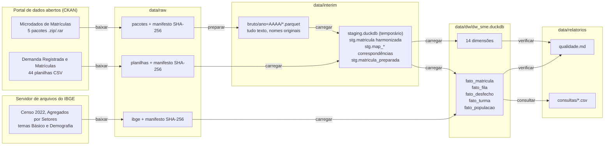

# Fluxo de dados

Cada seta é uma etapa do comando `dw-sme` (ver [Como executar](07-como-executar.md)). As etapas são independentes: dá para rodar `carregar` de novo sem baixar nada, ou `verificar` sem recarregar.

## Etapa 1: baixar

Módulos: `extracao/ckan.py`, `extracao/fontes.py`.

O cliente consulta a API `package_show` do portal para as duas bases e escolhe os recursos pelo nome, que carrega o período ("Microdados de Matrículas - 2015-2018", "Demanda e Matrículas - Jun/2024", "Demanda por Vagas - 2006 a 2017"). Só entra o que intercepta o recorte pedido.

O IBGE não usa CKAN: os Agregados por Setores ficam num diretório navegável. O módulo `extracao/ibge.py` lê a listagem do diretório e das subpastas, escolhe os arquivos dos temas Básico e Demografia pelo nome (CSV antes de XLSX; entre versões, a de nome maior) e baixa os dois com o mesmo manifesto. A população é complementar: se o diretório não responder, a etapa avisa e o pipeline segue; os dois arquivos podem ser colocados à mão em `data/raw/ibge/`. `--sem-ibge` desliga o download.

Por que assim:

- **User-Agent obrigatório.** Sem ele o portal devolve uma página HTML de bloqueio com código 200, não um erro. O cliente sempre envia um User-Agent descritivo e trata resposta que não é JSON como erro.
- **Manifesto com SHA-256.** Os pacotes somam ~900 MB. O manifesto evita baixar de novo e detecta arquivo corrompido ou alterado.
- **Download em blocos de 1 MB**, com o hash calculado durante a escrita e arquivo `.parcial` renomeado só no fim, para que uma queda de rede não deixe um arquivo truncado com nome de completo.

## Etapa 2: preparar

Módulos: `preparacao.py`, `extracao/arquivos.py`.

Cada CSV de escolarização dentro dos pacotes é extraído, lido pelo DuckDB com todas as colunas como texto e gravado como Parquet em `data/interim/bruto/ano=AAAA/`. O CSV extraído é apagado logo em seguida.

Por que assim:

- **Tudo como texto.** Ler como número na entrada destruiria a evidência dos defeitos (código em notação científica, vírgula decimal, serial do Excel). O texto bruto é preservado e toda conversão acontece depois, com regra explícita e testada.
- **Parquet por arquivo.** Dez anos ocupam ~8 GB em CSV e ~420 MB em Parquet. Um arquivo de cada vez mantém o uso de disco baixo.
- **Encoding e separador detectados**, não fixados por ano: a detecção é a regra, a lista de exceções não existe.

## Etapa 3: carregar

Módulos: `carga/carregar.py`, `transformacao/*`.

1. **Esquema `dw` recriado** a partir de `sql/ddl/*.sql`.
2. **Staging harmonizado.** Para cada Parquet bruto, `transformacao/microdados.py` gera um SELECT que leva as colunas encontradas ao vocabulário canônico (a idade tem três nomes ao longo da série, a deficiência dois prefixos). O filtro de escolarização é aplicado aqui.
3. **Tabelas de correspondência.** As regras de normalização (`normalizacao.py`, `etapas.py`, `escolas.py`) rodam em Python sobre os valores **distintos** de cada coluna (96 distritos, 148 combinações de série, ~39 mil escolas-ano), não sobre os 13 milhões de linhas. O resultado vira uma tabela `stg.map_*` que o DuckDB junta com o staging.
4. **Matrícula preparada.** Uma única passada resolve, para cada linha, a chave natural de todas as dimensões: escola (pelo mapa de identificação), série, turno, idade, datas e os códigos de combinação das bugigangas.
5. **Planilhas de fila** lidas pelo parser de `fila.py` e filtradas pelo recorte.
6. **Dimensões e fatos** inseridos com chave artificial. O fato de turma é agregado do fato de matrícula, agrupando pelo `id_turma`.
7. **População do Censo 2022**, lida por `transformacao/populacao.py` quando os dois temas estão em `data/raw/ibge/`: só os setores do município, ligados ao distrito pelo nome normalizado e gravados no mês de referência do Censo (julho de 2022).
8. **Observações por ano** escritas na dimensão Ano Letivo a partir de métricas do próprio dado.

Por que assim:

- **Staging em arquivo separado.** O DuckDB não devolve ao disco o espaço de tabela apagada; com o staging no mesmo arquivo, o banco chegava a 2,85 GB.
- **Regras em Python, execução em SQL.** As regras ficam legíveis e testáveis caso a caso em Python. Onde a regra precisa rodar linha a linha (idade, datas, desfecho), ela existe também em SQL, e um teste garante que as duas versões dão o mesmo resultado.
- **Conversão uma vez por linha.** Idade e datas são convertidas numa CTE intermediária, não repetidas dentro de cada expressão. Essa mudança tirou a etapa de mais de 5 minutos para 51 segundos.

## Etapa 4: verificar

Módulo: `qualidade/verificacoes.py`. Doze verificações sobre o banco pronto, com relatório em `data/relatorios/qualidade.md`. O último relatório gerado com os dados reais está em [relatorios/qualidade.md](relatorios/qualidade.md).

## Etapa 5: consultar

Módulo: `consultas/executar.py`. Roda as oito consultas de `sql/consultas/` e grava um CSV por consulta. Ver [Consultas](05-consultas.md).
