# Modelo dimensional

O data warehouse responde a uma pergunta: **onde existe fila por vaga na rede municipal de educação de São Paulo, onde existe oferta, e o que acontece com quem consegue a vaga**. Cinco processos de negócio sustentam essa pergunta, cada um com sua tabela de fatos, e cobrem os assuntos de interesse registrados pelo grupo (matrículas; fila; capacidade e ocupação das turmas; população em idade escolar; oferta escolar por setor). As cinco tabelas compartilham dimensões e formam uma constelação.

O DDL completo está em [`src/dw_sme/sql/ddl/`](../src/dw_sme/sql/ddl/).

## Processos de negócio e grão

| Processo | Tabela de fatos | Grão | Fonte |
|---|---|---|---|
| Matrícula | `fato_matricula` | um vínculo aluno-turma em um ano letivo | Microdados da Rede Municipal, Matrículas |
| Fila por vaga | `fato_fila` | distrito × mês de referência × etapa | Demanda Registrada e Matrículas |
| Desfecho da matrícula | `fato_desfecho` | versão de escola × ano letivo × série | agregado do fato de matrícula |
| Ocupação de turma | `fato_turma` | uma turma em um ano letivo | agregado do fato de matrícula |
| População residente | `fato_populacao` | setor censitário × faixa etária × data de referência do Censo | Censo Demográfico 2022 (IBGE) |

O grão foi declarado antes das dimensões em cada caso. O fato de matrícula usa o grão mais fino que a fonte permite; o de fila usa o grão em que a prefeitura publica; o de desfecho é um fato agregado, porque as taxas de rendimento só fazem sentido sobre um conjunto de alunos; o de turma também é agregado, porque a ocupação é uma propriedade da turma e não do aluno; o de população usa o grão em que o IBGE publica.

| Assunto de interesse (planilha do grupo) | Onde está no modelo |
|---|---|
| Matrículas | `fato_matricula` |
| Fila (demanda registrada) | `fato_fila` |
| Capacidade e ocupação das turmas | `fato_turma` (ocupação medida; a capacidade não é publicada por nenhuma fonte, ver D19) e `qtd_matriculas_em_processo` de `fato_fila` (vaga oferecida aguardando documentação) |
| População em idade escolar | `fato_populacao` |
| Oferta escolar por setor | rede (setor público direto ou conveniado) em `dim_escola`; território em `dim_territorio` e `dim_setor_censitario`; consultas C3, C4, C7 e C8 |

## Constelação

```mermaid
erDiagram
    fato_matricula }o--|| dim_ano_letivo : "ano"
    fato_matricula }o--|| dim_data : "início (papel 1)"
    fato_matricula }o--|| dim_data : "fim (papel 2)"
    fato_matricula }o--|| dim_escola : "escola"
    fato_matricula }o--|| dim_territorio : "distrito da escola"
    fato_matricula }o--|| dim_serie : "série"
    fato_matricula }o--|| dim_turno : "turno"
    fato_matricula }o--|| dim_idade : "idade"
    fato_matricula }o--|| dim_perfil_aluno : "perfil"
    fato_matricula }o--|| dim_deficiencia : "deficiência"
    fato_matricula }o--|| dim_situacao_matricula : "situação"
    fato_fila }o--|| dim_tempo : "mês"
    fato_fila }o--|| dim_territorio : "distrito"
    fato_fila }o--|| dim_etapa : "etapa"
    fato_desfecho }o--|| dim_ano_letivo : "ano"
    fato_desfecho }o--|| dim_escola : "escola"
    fato_desfecho }o--|| dim_territorio : "distrito"
    fato_desfecho }o--|| dim_serie : "série"
    fato_turma }o--|| dim_ano_letivo : "ano"
    fato_turma }o--|| dim_escola : "escola"
    fato_turma }o--|| dim_territorio : "distrito"
    fato_turma }o--|| dim_serie : "série"
    fato_turma }o--|| dim_turno : "turno"
    fato_populacao }o--|| dim_tempo : "mês do Censo"
    fato_populacao }o--|| dim_setor_censitario : "setor"
    fato_populacao }o--|| dim_territorio : "distrito"
    fato_populacao }o--|| dim_faixa_etaria : "faixa"
```

A constelação se fecha em cinco pontos:

- **Território** é compartilhada diretamente pelos cinco fatos, no mesmo grão (distrito).
- **Tempo** aparece em três grãos, todos conformados: `dim_data` (dia) e `dim_tempo` (mês) se ligam por ano e mês; `dim_ano_letivo` (ano) é o rollup encolhido das duas. A população entra pelo mês do Censo em `dim_tempo`.
- **Etapa** aparece em dois grãos: `dim_serie` (série) carrega o código da etapa, e `dim_etapa` (etapa) é o seu rollup encolhido.
- **Idade** aparece em dois grãos: `dim_idade` (idade simples) carrega a faixa do IBGE, e `dim_faixa_etaria` (faixa) é o seu rollup encolhido.
- **Território abaixo do distrito** existe só no IBGE: `dim_setor_censitario` (setor) carrega o distrito, e `dim_territorio` é o seu rollup encolhido.

Rollup encolhido (*shrunken rollup dimension*) é a dimensão que contém um subconjunto conformado dos atributos de outra, num grão mais alto. É o que permite unir a fila, publicada por mês e etapa, com a matrícula, registrada por dia e série, e a população, publicada por setor e faixa etária, com a matrícula, registrada por escola e idade.

## Dimensões

Todas as dimensões têm chave primária artificial (inteiro sequencial). As chaves naturais da origem ficam guardadas como atributo.

Notação das hierarquias: `A ≤ B` significa que A é agregado em B (cada valor de A pertence a um único valor de B).

### dim_tempo (grão: mês)

| Atributo | Descrição |
|---|---|
| `chave_tempo` | chave artificial |
| `data_referencia`, `ano_mes` | primeiro dia do mês e rótulo `AAAA-MM` |
| `mes`, `nome_mes`, `bimestre`, `trimestre`, `semestre`, `ano` | componentes do calendário |
| `fila_publicada` | existe planilha de fila para o mês |
| `observacao` | nota técnica publicada no rodapé da planilha (por exemplo, a greve de março de 2018) |

Hierarquias: `mês ≤ trimestre ≤ semestre ≤ ano` e `mês ≤ bimestre ≤ ano`. São duas porque a prefeitura publicou a fila por trimestre até 2022 e por bimestre a partir de 2023.

### dim_data (grão: dia), com visão para dois papéis

| Atributo | Descrição |
|---|---|
| `chave_data` | chave artificial |
| `data` | a data; nula no membro "não informada" |
| `dia`, `mes`, `nome_mes`, `trimestre`, `semestre`, `ano` | componentes do calendário |
| `dia_semana`, `nome_dia_semana`, `fim_de_semana` | dia da semana |

O fato de matrícula aponta para esta dimensão duas vezes: data de início e data de fim da matrícula. É a mesma construção da Dimensão Data com visão para dois papéis do artigo da disciplina (data de internação e data de alta). As duas datas juntas permitem contar as matrículas ativas num dia, que é a medida comparável com a fila. Hierarquia: `dia ≤ mês ≤ trimestre ≤ semestre ≤ ano`.

### dim_ano_letivo (grão: ano)

| Atributo | Descrição |
|---|---|
| `chave_ano_letivo` | chave artificial |
| `ano` | ano letivo |
| `qualidade_codigo_escola` | CONFIAVEL, CONSISTENTE_NO_ANO ou CORROMPIDO, medido no próprio dado |
| `observacao` | limitações do microdado daquele ano, escritas pela carga a partir de métricas |

### dim_territorio (grão: distrito)

| Atributo | Descrição |
|---|---|
| `chave_territorio` | chave artificial |
| `distrito` | um dos 96 distritos, ou o membro NAO INFORMADO |
| `dre` | Diretoria Regional de Educação predominante do distrito |
| `participacao_dre` | fração das matrículas do distrito que estão nessa DRE |
| `municipio`, `uf` | SAO PAULO, SP |

Hierarquia: `distrito ≤ DRE ≤ município ≤ UF`. A planilha de fila só traz o distrito; a DRE vem do microdado, calculada como a DRE com mais matrículas em cada distrito. Entre 2015 e 2021, no máximo dois distritos por ano têm escolas em mais de uma DRE, e `participacao_dre` mostra o quanto a regra é exata em cada caso.

### dim_escola (grão: versão da escola), mudança lenta tipo 2

| Atributo | Descrição | Tipo de mudança |
|---|---|---|
| `chave_escola` | chave artificial da versão | |
| `cod_escola` | código SME, ou `SINT-...` quando sintético | chave natural |
| `codigo_sintetico` | a escola nunca teve código confiável publicado | |
| `versao`, `ano_inicio`, `ano_fim`, `versao_atual` | controle da versão | |
| `nome_escola`, `tipo_escola`, `distrito`, `dre` | atributos que abrem versão nova quando mudam | tipo 2 |
| `rede` | DIRETA, CONVENIADA, OUTRAS SECRETARIAS ou PARTICULAR, derivada do tipo | tipo 2 |
| `setor_sme` | setor administrativo da Secretaria (não é setor censitário) | tipo 1 |
| `situacao` | ATIVA, EXTINTA, PARALISADA, CRIADA | tipo 1 |

Hierarquia: `escola ≤ tipo de unidade ≤ rede`. O tipo 2 existe porque 402 escolas mudam de nome, tipo, distrito ou DRE ao longo da série; o caso típico é a creche conveniada que troca de organização e de nome mantendo o código. Cada matrícula aponta para a versão vigente no seu ano.

### dim_etapa (grão: etapa) e dim_serie (grão: série)

| dim_etapa | Descrição |
|---|---|
| `chave_etapa`, `codigo` | chave artificial e código (CRECHE, PRE, FUND_I, FUND_II, MEDIO, EJA_I, EJA_II, MOVA, PROJOVEM, ED_PROF) |
| `etapa`, `nivel`, `ordem` | nome, nível de ensino e ordem de exibição |

| dim_serie | Descrição |
|---|---|
| `chave_serie` | chave artificial |
| `modalidade`, `segmento`, `serie` | combinação publicada no microdado (chave natural) |
| `ciclo`, `ordem_serie` | ciclo de alfabetização, interdisciplinar ou autoral; ano do fundamental |
| `educacao_especial` | turma de educação especial |
| `codigo_etapa`, `etapa`, `nivel` | etapa conformada com `dim_etapa` |

Hierarquias de `dim_serie`: `série ≤ etapa ≤ nível` e `série ≤ ciclo`. As duas são paralelas porque o ciclo interdisciplinar cobre o 4º, 5º e 6º anos, e por isso atravessa a fronteira entre anos iniciais (FUND_I) e anos finais (FUND_II).

### dim_turno

| Atributo | Descrição |
|---|---|
| `chave_turno` | chave artificial |
| `turno` | MANHA, INTERMEDIARIO, TARDE, VESPERTINO, NOITE, INTEGRAL ou NAO INFORMADO |
| `jornada` | PARCIAL DIURNO, NOTURNO ou INTEGRAL |
| `origem_turno` | PUBLICADO, CODIGO_2021, HORARIO ou NAO_INFORMADO |

Hierarquia: `turno ≤ jornada`. A origem fica na dimensão porque o turno de 2021 não foi publicado e é deduzido do código da turma, e o de uma parte de 2022 é deduzido do horário.

### dim_idade

| Atributo | Descrição |
|---|---|
| `chave_idade`, `idade` | idade em 31 de março do ano letivo; nula no membro "não informada" |
| `faixa_escolar` | 0 a 3, 4 e 5, 6 a 10, 11 a 14, 15 a 17, 18 a 29, 30 ou mais |
| `faixa_ibge` | mesmo corte quinquenal dos Agregados por Setores do Censo 2022 |
| `grupo_etario` | criança, adolescente, adulto, idoso |

Hierarquias paralelas: `idade ≤ faixa escolar ≤ grupo etário` e `idade ≤ faixa IBGE`. A faixa IBGE conforma a dimensão Idade com a dimensão Faixa Etária, usada pela população residente.

### dim_faixa_etaria (grão: faixa quinquenal do IBGE)

| Atributo | Descrição |
|---|---|
| `chave_faixa_etaria` | chave artificial |
| `faixa_ibge` | 0 A 4 ANOS, 5 A 9 ANOS, ..., 70 ANOS OU MAIS; mesmo rótulo de `dim_idade.faixa_ibge` (conformidade) |
| `idade_inicial`, `idade_final` | limites da faixa; `idade_final` nula na faixa aberta |
| `variavel_ibge` | variável de origem no tema Demografia (`V01031` a `V01041`) |
| `ordem` | ordem de exibição |

É o rollup encolhido de `dim_idade`. Existe mesmo quando a população não está carregada, como catálogo, do mesmo jeito que `dim_etapa`.

### dim_setor_censitario (grão: setor censitário)

| Atributo | Descrição |
|---|---|
| `chave_setor_censitario` | chave artificial |
| `cd_setor` | código de 15 dígitos do IBGE (chave natural) |
| `cd_distrito_ibge` | 9 primeiros dígitos: UF, município e distrito |
| `nome_distrito_ibge` | nome do distrito como o IBGE publica (com acento) |
| `distrito` | nome normalizado, igual à chave natural de `dim_territorio` |
| `municipio`, `uf` | SAO PAULO, SP |

Hierarquia: `setor censitário ≤ distrito ≤ DRE ≤ município ≤ UF`. A DRE não está no IBGE: vem de `dim_territorio`, pela conformidade no distrito. O setor censitário é a unidade mais fina do modelo, mas só a população é publicada nele; a escola só tem distrito (e `setor_sme`, que é outro conceito, ver homônimos em [04](04-integracao-e-qualidade.md)).

### Dimensões bugiganga

Três dimensões agrupam indicadores de baixa cardinalidade que, sozinhos, gerariam dezenas de dimensões de duas ou três linhas.

| Dimensão | O que agrupa | Chave natural |
|---|---|---|
| `dim_perfil_aluno` | sexo, raça e cor, altas habilidades, idade estimada | combinação dos quatro valores |
| `dim_deficiencia` | os 17 indicadores DEF_* | texto de 17 posições: `1` presente, `0` ausente, `-` não coletado |
| `dim_situacao_matricula` | os 12 indicadores SIT_AL_* e a situação textual, mais o desfecho resumido | texto de 12 posições e a situação |

O valor `-` (não coletado) importa: quatro indicadores de deficiência só passam a existir em 2024, e marcar ausência como falso faria parecer que nenhum aluno tinha a condição antes disso.

## Tabelas de fatos

### fato_matricula

| Coluna | Tipo | Aditividade | Agregação |
|---|---|---|---|
| 11 chaves de dimensão | chave | | |
| `id_turma` | dimensão degenerada | | |
| `cd_matricula_origem` | dimensão degenerada | | |
| `qtd_matricula` | campo artificial = 1 | aditivo | SOMA |
| `qtd_dias_matricula` | medida | aditivo | SOMA (média por divisão) |

É uma tabela de fatos sem fato: cada linha registra a existência do vínculo, e `qtd_matricula` é o campo artificial que permite somar e agrupar, como no esquema de Ocupação de Instalações do artigo da disciplina. `id_turma` é construído (ano, escola, turma, série e turno) porque o código de turma publicado está corrompido de 2022 em diante; `cd_matricula_origem` fica nulo nos anos em que o código foi destruído.

### fato_fila

| Coluna | Aditividade | Agregação |
|---|---|---|
| `formato_planilha` | dimensão degenerada (formato A a F ou H) | |
| `qtd_matriculas` | semiaditivo | SOMA entre distritos e etapas; último valor no tempo |
| `qtd_matriculas_em_processo` | semiaditivo | idem |
| `qtd_demanda_total` | semiaditivo | idem |
| `qtd_demanda_sem_opcao` | semiaditivo | idem |
| `qtd_demanda_sem_opcao_ate_30d` | semiaditivo | idem |
| `qtd_demanda_sem_opcao_mais_30d` | semiaditivo | idem |
| `qtd_demanda_com_opcao` | semiaditivo | idem |

Todas as medidas são estoques na data de referência. Somar a fila de fevereiro com a de abril conta a mesma criança duas vezes, então no tempo vale o valor de um único mês (último, ou média). Medida nula significa "não publicada naquele período" e é diferente de zero: a quebra entre espera de até 30 dias e mais de 30 dias só existe de setembro de 2020 em diante.

### fato_desfecho

| Coluna | Aditividade | Agregação |
|---|---|---|
| `qtd_matriculas` | aditivo | SOMA |
| `qtd_aprovados`, `qtd_reprovados`, `qtd_abandonos`, `qtd_transferidos`, `qtd_concluintes`, `qtd_falecidos`, `qtd_outras_saidas`, `qtd_em_curso`, `qtd_sem_desfecho` | aditivo | SOMA |
| `taxa_aprovacao`, `taxa_reprovacao`, `taxa_abandono` (visão `vw_desfecho_taxas`) | não aditivo, derivado | recalcular a partir das contagens |

As contagens por desfecho são exclusivas e somam `qtd_matriculas` (a verificação Q03 confere). As taxas são derivadas: aprovados, reprovados ou abandonos divididos pela soma dos três, como no indicador de rendimento do INEP. Média de taxas entre escolas de tamanhos diferentes dá resultado errado, por isso a visão expõe as contagens junto.

### fato_turma

| Coluna | Tipo | Aditividade | Agregação |
|---|---|---|---|
| 5 chaves de dimensão (Ano Letivo, Escola, Território, Série, Turno) | chave | | |
| `id_turma` | dimensão degenerada (a mesma de `fato_matricula`) | | |
| `qtd_turmas` | campo artificial = 1 | aditivo | SOMA |
| `qtd_matriculas` | vínculos aluno-turma no ano | aditivo | SOMA |
| `qtd_matriculas_ativas_junho` | alunos ativos em 30/06 | aditivo | SOMA |
| `qtd_turmas_ativas_junho` | 1 se a turma tinha aluno ativo em 30/06 | aditivo | SOMA |
| `alunos_por_turma_junho` (visão `vw_ocupacao_turma`) | derivado | não aditivo | recalcular: soma de alunos ativos ÷ soma de turmas ativas |

Fato agregado a partir de `fato_matricula`, agrupando pelo `id_turma`. A soma de `qtd_matriculas` é igual à do fato de matrícula, e há uma linha por turma (verificação Q11). Ativa em 30/06 segue a regra de C5: início até a data e fim depois dela ou não informado. Em 2021, que não publicou datas, as duas medidas de junho ficam nulas, não zero. Os vínculos do ano superam os alunos de um dia porque contam também quem saiu ou entrou durante o ano; por isso a ocupação usa os ativos numa data. A capacidade (vagas por turma) não é publicada por nenhuma das fontes e não é inventada (D19).

### fato_populacao

| Coluna | Aditividade | Agregação |
|---|---|---|
| 4 chaves de dimensão (Tempo, Setor Censitário, Território, Faixa Etária) | | |
| `qtd_pessoas` | semiaditivo | SOMA entre setores, distritos e faixas; no tempo, valor de um único Censo |

Estoque na data de referência do Censo, como a fila. Valor não numérico na origem vira nulo (não publicado), nunca zero. O fato carrega `chave_territorio` além do setor, como o fato de matrícula carrega território além da escola, para que o *drill-across* com os outros fatos use a mesma chave.

## Recursos de modelagem usados

| Recurso | Onde |
|---|---|
| Chave artificial | todas as 14 dimensões |
| Tabela bugiganga | `dim_perfil_aluno`, `dim_deficiencia`, `dim_situacao_matricula` |
| Dimensão degenerada | `id_turma` e `cd_matricula_origem` em `fato_matricula`; `id_turma` em `fato_turma`; `formato_planilha` em `fato_fila` |
| Tabela de fatos sem fato | `fato_matricula` (`qtd_matricula` = 1) |
| Visão para dois papéis | `dim_data` como início e fim da matrícula |
| Mudança lenta tipo 2 | `dim_escola` |
| Rollup encolhido conformado | `dim_ano_letivo` de `dim_tempo`/`dim_data`; `dim_etapa` de `dim_serie`; `dim_faixa_etaria` de `dim_idade`; `dim_territorio` de `dim_setor_censitario` |
| Fato agregado | `fato_desfecho` e `fato_turma`, derivados de `fato_matricula` |
| Fato derivado não aditivo | taxas em `vw_desfecho_taxas`; alunos por turma em `vw_ocupacao_turma` |
| Fato semiaditivo | medidas de `fato_fila` e `fato_populacao` (estoques) |
| Membro "não informado" | `dim_territorio`, `dim_data`, `dim_idade`, `dim_turno` |
